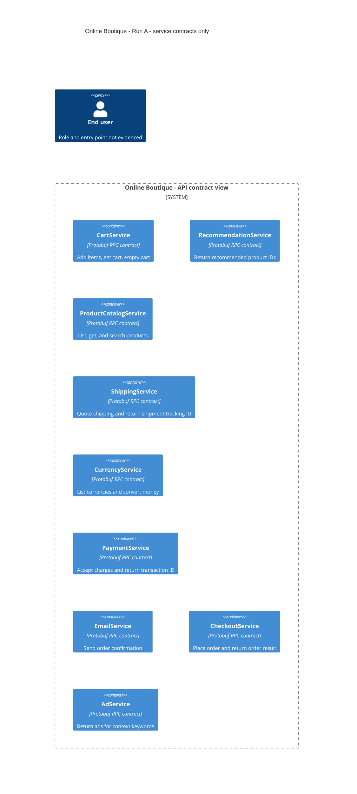

# Architecture recovery — Run A

## Agent

Codex. Exact model identifier: unknown; not reliably exposed in this session.

## Files read

Architectural evidence for this run:

- `system/online-boutique/protos/demo.proto` — the only source file used to recover architectural facts.

Instructions read earlier in this same chat:

- `AGENTS.md` — repository rules.
- `prompts/1-recover-architecture.md` — task instructions.
- `/Users/chavaponsuu/.codex/attachments/0cc5b023-f71c-4455-8917-8922eecfa106/Pasted text.txt` — the student's assignment instructions, read during setup before the repository was cloned.

Output read back for verification:

- `exercise/outputs/1A-architecture.md` — this generated document; not used as architectural evidence.

This run continued the setup chat rather than starting a fresh session. Workspace/repository directory entries were listed during setup, and the output file's existence was checked. No other repository file contents, upstream repository, or review-board cards were read. The prompt-log worksheet was supplied as chat text, not opened as a file.

## Containers table

The evidence declares nine service contracts in the `hipstershop` package (`demo.proto:17`). The rows and diagram below represent those declared service boundaries. A one-to-one mapping to independently deployed C4 containers is **Not evidenced in the provided files**.

The schema uses Protocol Buffers `proto3` (`system/online-boutique/protos/demo.proto:15`). Implementation languages, frameworks, running instances, and deployed RPC transport are **Not evidenced in the provided files**. The `go_package` option at line 19 specifies a Go generated-package path; it does not establish that any service implementation is written in Go.

| Name | Technology/language | Responsibility exposed by the contract | Evidence (file path, lines, symbols) |
|---|---|---|---|
| CartService | Protobuf RPC contract; implementation unknown | Add an item, retrieve a user's cart, and empty a user's cart. | `system/online-boutique/protos/demo.proto:23–27` — `CartService.AddItem`, `GetCart`, `EmptyCart`; user IDs in request messages at lines 34–45. |
| RecommendationService | Protobuf RPC contract; implementation unknown | Return recommended product IDs for a request containing a user ID and product IDs. | `system/online-boutique/protos/demo.proto:56–67` — `ListRecommendations`, `ListRecommendationsRequest`, `ListRecommendationsResponse`. |
| ProductCatalogService | Protobuf RPC contract; implementation unknown | List products, retrieve a product by ID, and search products by a query. | `system/online-boutique/protos/demo.proto:71–75,93–103` — `ListProducts`, `GetProduct`, `SearchProducts` and their request/response types. |
| ShippingService | Protobuf RPC contract; implementation unknown | Quote shipping cost and expose shipment creation returning a tracking ID. | `system/online-boutique/protos/demo.proto:107–128` — `GetQuote`, `ShipOrder`, `GetQuoteResponse.cost_usd`, `ShipOrderResponse.tracking_id`. |
| CurrencyService | Protobuf RPC contract; implementation unknown | List supported currency codes and convert a money amount to a requested currency. | `system/online-boutique/protos/demo.proto:140–143,163–173` — `GetSupportedCurrencies`, `Convert`, `CurrencyConversionRequest`. |
| PaymentService | Protobuf RPC contract; implementation unknown | Accept a charge request with an amount and credit-card information, returning a transaction ID. | `system/online-boutique/protos/demo.proto:177–195` — `Charge`, `ChargeRequest`, `ChargeResponse.transaction_id`. |
| EmailService | Protobuf RPC contract; implementation unknown | Expose order-confirmation email sending for an email address and an order result. | `system/online-boutique/protos/demo.proto:199–201,216–219` — `SendOrderConfirmation`, `SendOrderConfirmationRequest`. |
| CheckoutService | Protobuf RPC contract; implementation unknown | Accept an order-placement request and return an order result. | `system/online-boutique/protos/demo.proto:224–239` — `PlaceOrder`, `PlaceOrderRequest`, `PlaceOrderResponse`. |
| AdService | Protobuf RPC contract; implementation unknown | Return advertisements with redirect URLs and text, using page-context keywords supplied in the request. | `system/online-boutique/protos/demo.proto:243–262` — `GetAds`, `AdRequest.context_keys`, `AdResponse`, `Ad`. |

Data stores and message brokers: **Not evidenced in the provided files**; none are added to the table or diagram.

## Dependencies table

| Caller → callee | Protocol | Evidence (file path and symbol) |
|---|---|---|

No runtime caller–callee relationship is evidenced, so the table has no dependency rows. `system/online-boutique/protos/demo.proto` declares callable RPC methods but contains no client calls, connection configuration, or service addresses. A deployed transport such as gRPC is **Not evidenced in the provided files**.

Shared message types establish schema references, not runtime calls. For example, `PlaceOrderRequest.credit_card` (`demo.proto:234`) and `SendOrderConfirmationRequest.order` (`demo.proto:218`) do not prove that `CheckoutService` calls `PaymentService` or `EmailService`.

## Mermaid diagram

The diagram contains exactly the nine service-contract entries above and zero dependency relationships. Container shapes visualize API service boundaries only; independent deployment remains unverified. The `Person` is the task-required end-user placeholder: user identity, entry point, and access protocol are **Not evidenced in the provided files**, so it has no relationship. The system name comes from the task instructions.

## Gaps

All items below are **Not evidenced in the provided files**. Suggested paths are **[Inferred] candidate evidence locations**; their existence and contents have not been checked or read in Run A. They require a later run with an expanded evidence scope.

| Unknown | Why this evidence is insufficient | Extra file(s) that would help settle it |
|---|---|---|
| Actual deployable containers, runtime languages, and additional services | A protobuf service declaration defines an API, not a running process. `go_package` does not identify implementation languages. | Deployment manifests matching `system/online-boutique/kubernetes-manifests/*.yaml` to identify workloads/images; corresponding entry points and build files under `system/online-boutique/src/` to verify languages. |
| Runtime dependencies and checkout orchestration | RPC signatures and shared request/result types do not identify callers or call order. | Client initialization and call sites, e.g. candidate `system/online-boutique/src/checkoutservice/main.go` and `system/online-boutique/src/frontend/rpc.go`; associated service-address configuration. |
| RPC transport, security, and endpoints | The file contains no channel setup, listener, TLS configuration, or network addresses. | The same caller/server implementation files and corresponding workload manifests; these would establish whether gRPC is used and how it is configured. |
| End-user entry point and access protocol | `user_id` fields identify request data; they do not establish a browser, frontend container, or HTTP/HTTPS connection. | Candidate `system/online-boutique/kubernetes-manifests/frontend.yaml` plus its application handlers and ingress configuration. |
| Persistence and external integrations | Cart/order messages do not prove persistence. Payment/email APIs do not identify a payment provider or email transport. | Implementation and configuration files under candidate `system/online-boutique/src/cartservice/`, `system/online-boutique/src/paymentservice/`, and `system/online-boutique/src/emailservice/`; relevant backing-store manifests, if present. |
| Failure handling and quality attributes | Signatures do not specify timeouts, retries, idempotency, durability, availability, latency, or scaling behavior. | Relevant RPC client/server implementations and deployment configuration; measured performance would additionally require test or operational evidence. |
