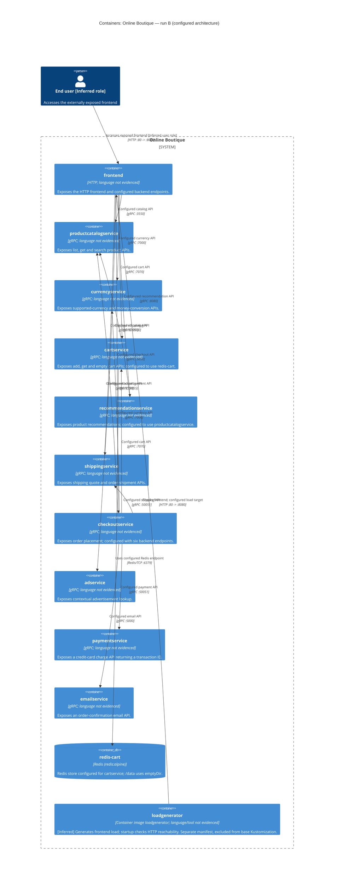

# Online Boutique architecture recovery — run B

## Agent

Codex, based on GPT-6; the exact deployed model variant is not available.

## Files read

Instruction files (not architectural evidence):

- `AGENTS.md`
- `prompts/1-recover-architecture.md`

Architecture evidence:

- `system/online-boutique/protos/demo.proto`
- `system/online-boutique/kubernetes-manifests/README.md`
- `system/online-boutique/kubernetes-manifests/adservice.yaml`
- `system/online-boutique/kubernetes-manifests/cartservice.yaml`
- `system/online-boutique/kubernetes-manifests/checkoutservice.yaml`
- `system/online-boutique/kubernetes-manifests/currencyservice.yaml`
- `system/online-boutique/kubernetes-manifests/emailservice.yaml`
- `system/online-boutique/kubernetes-manifests/frontend.yaml`
- `system/online-boutique/kubernetes-manifests/kustomization.yaml`
- `system/online-boutique/kubernetes-manifests/loadgenerator.yaml`
- `system/online-boutique/kubernetes-manifests/paymentservice.yaml`
- `system/online-boutique/kubernetes-manifests/productcatalogservice.yaml`
- `system/online-boutique/kubernetes-manifests/recommendationservice.yaml`
- `system/online-boutique/kubernetes-manifests/shippingservice.yaml`

All paths are relative to the repository root. No application implementation files were opened.

## Containers table

The table covers the ten application services and Redis in the base resources, plus the separately defined load generator: `system/online-boutique/kubernetes-manifests/kustomization.yaml:17-28`, `system/online-boutique/kubernetes-manifests/cartservice.yaml:89-156` (`redis-cart`) and `system/online-boutique/kubernetes-manifests/loadgenerator.yaml:14-24` (`loadgenerator`). The load generator is excluded from the base Kustomization, so its presence here does not assert that it is deployed.

For application services and the load generator, implementation language/framework: **Not evidenced in the provided files**. Responsibilities below describe API contracts or configuration; they do not verify the implementations.

| Name | Technology/language | Responsibility | Evidence |
| --- | --- | --- | --- |
| `frontend` | HTTP; language not evidenced | Exposes the HTTP frontend and configured backend endpoints. | `system/online-boutique/kubernetes-manifests/frontend.yaml:18` (`frontend`); `system/online-boutique/kubernetes-manifests/frontend.yaml:47-49` (`image: frontend`); `system/online-boutique/kubernetes-manifests/frontend.yaml:69-82`; `system/online-boutique/kubernetes-manifests/frontend.yaml:123-136` (`LoadBalancer`). |
| `productcatalogservice` | gRPC; language not evidenced | Exposes list, get and search product APIs. | `system/online-boutique/kubernetes-manifests/productcatalogservice.yaml:46-59` (`image: productcatalogservice`); `system/online-boutique/protos/demo.proto:71-86` (`ProductCatalogService`). |
| `currencyservice` | gRPC; language not evidenced | Exposes supported-currency and money-conversion APIs. | `system/online-boutique/kubernetes-manifests/currencyservice.yaml:46-60` (`image: currencyservice`); `system/online-boutique/protos/demo.proto:140-143` (`CurrencyService`). |
| `cartservice` | gRPC; language not evidenced | Exposes add, get and empty cart APIs; configured to use redis-cart. | `system/online-boutique/kubernetes-manifests/cartservice.yaml:46-51` (`REDIS_ADDR`); `system/online-boutique/kubernetes-manifests/cartservice.yaml:79-82` (`grpc`); `system/online-boutique/protos/demo.proto:23-49` (`CartService`). |
| `recommendationservice` | gRPC; language not evidenced | Exposes product recommendations; configured to use productcatalogservice. | `system/online-boutique/kubernetes-manifests/recommendationservice.yaml:46-63` (`PRODUCT_CATALOG_SERVICE_ADDR`); `system/online-boutique/protos/demo.proto:56-66` (`RecommendationService`). |
| `shippingservice` | gRPC; language not evidenced | Exposes shipping quote and order-shipment APIs. | `system/online-boutique/kubernetes-manifests/shippingservice.yaml:45-59` (`image: shippingservice`); `system/online-boutique/protos/demo.proto:107-127` (`ShippingService`). |
| `checkoutservice` | gRPC; language not evidenced | Exposes order placement; configured with six backend endpoints. | `system/online-boutique/kubernetes-manifests/checkoutservice.yaml:45-68` (`image: checkoutservice`); `system/online-boutique/protos/demo.proto:224-238` (`CheckoutService`). |
| `adservice` | gRPC; language not evidenced | Exposes contextual advertisement lookup. | `system/online-boutique/kubernetes-manifests/adservice.yaml:46-68` (`image: adservice`); `system/online-boutique/protos/demo.proto:243-261` (`AdService`). |
| `paymentservice` | gRPC; language not evidenced | Exposes a credit-card charge API returning a transaction ID. | `system/online-boutique/kubernetes-manifests/paymentservice.yaml:46-59` (`image: paymentservice`); `system/online-boutique/protos/demo.proto:177-194` (`PaymentService`). |
| `emailservice` | gRPC; language not evidenced | Exposes an order-confirmation email API. | `system/online-boutique/kubernetes-manifests/emailservice.yaml:46-61` (`image: emailservice`); `system/online-boutique/protos/demo.proto:199-218` (`EmailService`). |
| `redis-cart` | Redis (redis:alpine) | Redis store configured for cartservice; /data uses emptyDir. | `system/online-boutique/kubernetes-manifests/cartservice.yaml:50-51` (`REDIS_ADDR`); `system/online-boutique/kubernetes-manifests/cartservice.yaml:89-120` (`image: redis:alpine`); `system/online-boutique/kubernetes-manifests/cartservice.yaml:129-141` (`emptyDir`). |
| `loadgenerator` | Container image loadgenerator; language/tool not evidenced | [Inferred] Generates frontend load; startup checks HTTP reachability. Separate manifest, excluded from base Kustomization. | `system/online-boutique/kubernetes-manifests/loadgenerator.yaml:14-24` (`loadgenerator`); `system/online-boutique/kubernetes-manifests/loadgenerator.yaml:40-70` (`http://${FRONTEND_ADDR}`); `system/online-boutique/kubernetes-manifests/loadgenerator.yaml:80-87` (`USERS`); `system/online-boutique/kubernetes-manifests/kustomization.yaml:24` (`# - loadgenerator.yaml`). |

## Dependencies table

These are configured application dependencies and the exposed frontend access path, not an observed execution trace. For gRPC rows, the caller environment variable identifies the destination; the callee Service port and protobuf service establish the protocol/API. No row asserts that a caller invokes every method in that API. The human end-user role is **[Inferred]** from external frontend exposure and the order-placement contract (`system/online-boutique/kubernetes-manifests/frontend.yaml:123-136` (`LoadBalancer`); `system/online-boutique/protos/demo.proto:224-238` (`PlaceOrder`)).

| Caller → callee | Protocol | Evidence |
| --- | --- | --- |
| End user [Inferred role] → `frontend` | HTTP :80 -> :8080 | `system/online-boutique/kubernetes-manifests/frontend.yaml:123-136` (`LoadBalancer`); `system/online-boutique/kubernetes-manifests/frontend.yaml:50-65` (`httpGet`). |
| `frontend` → `productcatalogservice` | gRPC :3550 | `system/online-boutique/kubernetes-manifests/frontend.yaml:69-70` (`PRODUCT_CATALOG_SERVICE_ADDR`); `system/online-boutique/kubernetes-manifests/productcatalogservice.yaml:79-81` (`grpc`); `system/online-boutique/protos/demo.proto:71-75` (`ProductCatalogService`). |
| `frontend` → `currencyservice` | gRPC :7000 | `system/online-boutique/kubernetes-manifests/frontend.yaml:71-72` (`CURRENCY_SERVICE_ADDR`); `system/online-boutique/kubernetes-manifests/currencyservice.yaml:80-82` (`grpc`); `system/online-boutique/protos/demo.proto:140-143` (`CurrencyService`). |
| `frontend` → `cartservice` | gRPC :7070 | `system/online-boutique/kubernetes-manifests/frontend.yaml:73-74` (`CART_SERVICE_ADDR`); `system/online-boutique/kubernetes-manifests/cartservice.yaml:80-82` (`grpc`); `system/online-boutique/protos/demo.proto:23-27` (`CartService`). |
| `frontend` → `recommendationservice` | gRPC :8080 | `system/online-boutique/kubernetes-manifests/frontend.yaml:75-76` (`RECOMMENDATION_SERVICE_ADDR`); `system/online-boutique/kubernetes-manifests/recommendationservice.yaml:83-85` (`grpc`); `system/online-boutique/protos/demo.proto:56-58` (`RecommendationService`). |
| `frontend` → `shippingservice` | gRPC :50051 | `system/online-boutique/kubernetes-manifests/frontend.yaml:77-78` (`SHIPPING_SERVICE_ADDR`); `system/online-boutique/kubernetes-manifests/shippingservice.yaml:79-81` (`grpc`); `system/online-boutique/protos/demo.proto:107-110` (`ShippingService`). |
| `frontend` → `checkoutservice` | gRPC :5050 | `system/online-boutique/kubernetes-manifests/frontend.yaml:79-80` (`CHECKOUT_SERVICE_ADDR`); `system/online-boutique/kubernetes-manifests/checkoutservice.yaml:88-90` (`grpc`); `system/online-boutique/protos/demo.proto:224-226` (`CheckoutService`). |
| `frontend` → `adservice` | gRPC :9555 | `system/online-boutique/kubernetes-manifests/frontend.yaml:81-82` (`AD_SERVICE_ADDR`); `system/online-boutique/kubernetes-manifests/adservice.yaml:81-83` (`grpc`); `system/online-boutique/protos/demo.proto:243-245` (`AdService`). |
| `checkoutservice` → `productcatalogservice` | gRPC :3550 | `system/online-boutique/kubernetes-manifests/checkoutservice.yaml:57-58` (`PRODUCT_CATALOG_SERVICE_ADDR`); `system/online-boutique/kubernetes-manifests/productcatalogservice.yaml:79-81` (`grpc`); `system/online-boutique/protos/demo.proto:71-75` (`ProductCatalogService`). |
| `checkoutservice` → `shippingservice` | gRPC :50051 | `system/online-boutique/kubernetes-manifests/checkoutservice.yaml:59-60` (`SHIPPING_SERVICE_ADDR`); `system/online-boutique/kubernetes-manifests/shippingservice.yaml:79-81` (`grpc`); `system/online-boutique/protos/demo.proto:107-110` (`ShippingService`). |
| `checkoutservice` → `paymentservice` | gRPC :50051 | `system/online-boutique/kubernetes-manifests/checkoutservice.yaml:61-62` (`PAYMENT_SERVICE_ADDR`); `system/online-boutique/kubernetes-manifests/paymentservice.yaml:79-81` (`grpc`); `system/online-boutique/protos/demo.proto:177-179` (`PaymentService`). |
| `checkoutservice` → `emailservice` | gRPC :5000 | `system/online-boutique/kubernetes-manifests/checkoutservice.yaml:63-64` (`EMAIL_SERVICE_ADDR`); `system/online-boutique/kubernetes-manifests/emailservice.yaml:81-83` (`grpc`); `system/online-boutique/protos/demo.proto:199-201` (`EmailService`). |
| `checkoutservice` → `currencyservice` | gRPC :7000 | `system/online-boutique/kubernetes-manifests/checkoutservice.yaml:65-66` (`CURRENCY_SERVICE_ADDR`); `system/online-boutique/kubernetes-manifests/currencyservice.yaml:80-82` (`grpc`); `system/online-boutique/protos/demo.proto:140-143` (`CurrencyService`). |
| `checkoutservice` → `cartservice` | gRPC :7070 | `system/online-boutique/kubernetes-manifests/checkoutservice.yaml:67-68` (`CART_SERVICE_ADDR`); `system/online-boutique/kubernetes-manifests/cartservice.yaml:80-82` (`grpc`); `system/online-boutique/protos/demo.proto:23-27` (`CartService`). |
| `recommendationservice` → `productcatalogservice` | gRPC :3550 | `system/online-boutique/kubernetes-manifests/recommendationservice.yaml:60-61` (`PRODUCT_CATALOG_SERVICE_ADDR`); `system/online-boutique/kubernetes-manifests/productcatalogservice.yaml:79-81` (`grpc`); `system/online-boutique/protos/demo.proto:71-75` (`ProductCatalogService`). |
| `cartservice` → `redis-cart` | Redis/TCP :6379 | `system/online-boutique/kubernetes-manifests/cartservice.yaml:50-51` (`REDIS_ADDR`); `system/online-boutique/kubernetes-manifests/cartservice.yaml:118-128` (`tcpSocket`); `system/online-boutique/kubernetes-manifests/cartservice.yaml:143-156` (`tcp-redis`). |
| `loadgenerator` → `frontend` | HTTP :80 -> :8080 | `system/online-boutique/kubernetes-manifests/loadgenerator.yaml:40-70` (`http://${FRONTEND_ADDR}`); `system/online-boutique/kubernetes-manifests/loadgenerator.yaml:82-87` (`FRONTEND_ADDR`); `system/online-boutique/kubernetes-manifests/frontend.yaml:108-121` (`http`). |

The load-generator HTTP relationship is explicit in its startup check; `FRONTEND_ADDR` also configures its main container. The main workload implementation is not supplied. Kubernetes Services, ServiceAccounts, health probes and the load-generator init helper are deployment details, not additional C4 application containers; the frontend Services both select the same `app: frontend` (`system/online-boutique/kubernetes-manifests/frontend.yaml:108-136`).

## Mermaid diagram

This diagram has the same 12 containers and 17 relationships as the tables. The separately defined load generator is qualified in its description. No external service provider is established by this evidence.

## Gaps

Follow-up files below were not read. Proposed implementation filenames are investigation targets whose existence must be confirmed; they are not additional evidence.

| Gap | What the supplied evidence establishes or leaves unknown | Extra file(s) to request |
| --- | --- | --- |
| Implementation languages and frameworks | Not evidenced in the provided files. `system/online-boutique/protos/demo.proto:15-19` (`go_package`) is an interface/compiler option, not proof of any server implementation language. | The Dockerfile and dependency manifest for each application and loadgenerator, e.g. `system/online-boutique/src/frontend/Dockerfile`, `system/online-boutique/src/frontend/go.mod` and the corresponding files for each other container. |
| Actual calls and checkout workflow | Environment variables establish configured targets, not which RPCs execute, call order, retries, timeouts or transaction/compensation behavior; `system/online-boutique/kubernetes-manifests/checkoutservice.yaml:57-68` and `system/online-boutique/kubernetes-manifests/frontend.yaml:69-82`. These behaviors are Not evidenced in the provided files. | Caller implementations, including proposed targets `system/online-boutique/src/frontend/rpc.go`, `system/online-boutique/src/checkoutservice/main.go` and `system/online-boutique/src/recommendationservice/recommendation_server.py`. |
| Unresolved assistant endpoint | `system/online-boutique/kubernetes-manifests/frontend.yaml:83-84` (`SHOPPING_ASSISTANT_SERVICE_ADDR`) sets `shoppingassistantservice:80`, while `system/online-boutique/kubernetes-manifests/frontend.yaml:93-94` (`ENABLE_ASSISTANT`) and `system/online-boutique/kubernetes-manifests/kustomization.yaml:29-36` (`shopping-assistant`) are commented. Its deployment, activation, protocol and ownership are Not evidenced in the provided files. It is not included as a proven runtime container or relationship. | `system/online-boutique/kustomize/components/shopping-assistant/kustomization.yaml`, its referenced manifests and `system/online-boutique/src/frontend/main.go` for activation logic. |
| Load generator participation and workload | The separate Deployment and startup HTTP check are evidenced, but `system/online-boutique/kubernetes-manifests/kustomization.yaml:24` (`# - loadgenerator.yaml`) excludes it from the base resources. The main tool, request scenarios, parameter units and whether it runs in a particular deployment are Not evidenced in the provided files. | `system/online-boutique/skaffold.yaml` (explicitly referenced by that comment), plus `system/online-boutique/src/loadgenerator/Dockerfile` and the workload implementation it names. |
| Redis data semantics and durability | `system/online-boutique/kubernetes-manifests/cartservice.yaml:129-141` (`emptyDir`) establishes an ephemeral `/data` volume. Key schema, TTL, Redis client/wire-protocol version, save configuration and recovery behavior are Not evidenced in the provided files. | The cart store implementation, proposed target `system/online-boutique/src/cartservice/src/cartstore/RedisCartStore.cs`, and any Redis configuration supplied by the deployment. |
| External providers and additional stores | Payment, shipment and email RPC contracts establish APIs, not a real payment gateway, carrier or SMTP provider: `system/online-boutique/protos/demo.proto:177-200`, `system/online-boutique/protos/demo.proto:107-127`. Such providers, a catalog/order database, and a message broker are Not evidenced in the provided files; none is added to the diagram. | Service implementations, proposed targets `system/online-boutique/src/paymentservice/index.js`, `system/online-boutique/src/shippingservice/main.go`, `system/online-boutique/src/emailservice/email_server.py`, `system/online-boutique/src/productcatalogservice/main.go` and `system/online-boutique/src/checkoutservice/main.go`, plus any provider/storage configuration they reference. |
| TLS, resolved images and deployed state | The supplied frontend exposure is HTTP port 80 (`system/online-boutique/kubernetes-manifests/frontend.yaml:123-136`). HTTPS/TLS termination, gRPC transport security and a running cluster topology are Not evidenced in the provided files. `system/online-boutique/kubernetes-manifests/README.md:3-8` says Skaffold must insert image tags; placeholder images do not identify deployed versions. | Deployment-specific Ingress/Gateway and TLS configuration files; frontend client/server transport code; `system/online-boutique/skaffold.yaml` and an exported, resolved Deployment/Service manifest from the target cluster. |
